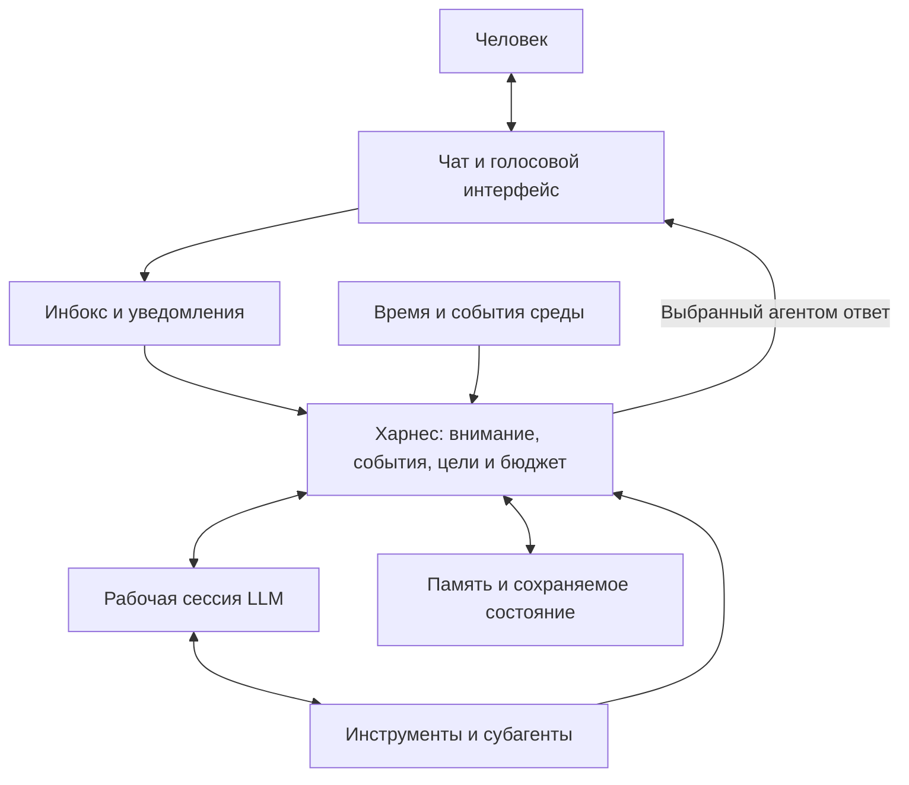

# Архитектура и требования к компонентам

Четыре основных компонента: LLM, память, инструменты и интерфейсы, харнес. Харнес включает управление мотивацией и целями, рабочим состоянием, событиями, вниманием, временем и бюджетом. Общие функциональные требования находятся в `functional-requirements.md`; условия первого эксперимента — в `first-experiment.md`.

## LLM

- **LLM-01. Подключение.** Поддерживать заменяемые адаптеры к моделям через доступные подписочные интерфейсы, API или локальный запуск.
- **LLM-02. Параллельные сессии.** Поддерживать независимые сессии для разговора, основной деятельности и субагентов. Для каждой роли должны настраиваться модель, контекст, параметры генерации и ограничения расхода.
- **LLM-03. Учёт ресурсов.** Передавать харнесу доступные данные о расходе, остатке квоты, периодах её обновления, токенах и стоимости. Неизвестные или устаревшие значения должны отличаться от подтверждённых.
- **LLM-04. Управление исполнением.** Поддерживать потоковый вывод, вызовы инструментов, отмену и доставку дополнительных входов во время работы. Передавать уведомления как наблюдения с указанием источника. Механика steer может использоваться для доставки выбранного входа или корректировки активного исполнения; клиентское сообщение само по себе не должно становиться командой steer или обязательным user-промптом.

## Память

- **MEM-01. Запоминание.** Для любого факта в рантайме предоставлять возможность долговременного сохранения и механизм решения о записи. Сохранять источник, время и различие между наблюдением, предположением и результатом действия.
- **MEM-02. Выучивание.** Извлекать из опыта обобщения, правила и повторно используемые навыки. Учитывать подтверждённые успехи и ошибки при их последующем применении и пересмотре; навыки связывать с доступными скиллами.
- **MEM-03. Доступ.** Предоставлять поиск по смыслу, точным признакам и времени. Автоматически подгружать в промпт базовую память и релевантный текущей деятельности опыт в пределах выделенного контекста.
- **MEM-04. Масштабирование.** Поддерживать индексацию, консолидацию и устранение дублей по мере роста памяти. Ограничивать объём подгрузки в промпт, сохраняя доступ к исходным сведениям и накопленному опыту между перезапусками.
- **MEM-05. Готовая реализация.** Использовать заменяемую open-source основу. Все её обращения к моделям, включая извлечение фактов и обобщение, должны проходить через общий учёт и ограничения бюджета.

Предварительная основа памяти — [Hindsight](https://github.com/vectorize-io/hindsight): сохранение, поиск, рефлексия, консолидация наблюдений и обновляемые обобщения. Базовая подгрузка и применение выученных навыков связываются с харнесом. Выбор предварительный; качество, расход и масштабирование на нашем сценарии ещё не проверены.

## Инструменты и интерфейсы

- **TOOL-01. Локальное исполнение.** Позволять запускать произвольный локальный код и команды, работать с файлами, процессами и окружением; возвращать вывод, ошибки и статус исполнения.
- **TOOL-02. Скиллы.** Позволять находить, читать, выбирать, создавать, обновлять и использовать скиллы.
- **TOOL-03. Подключение среды.** Позволять добавлять инструменты и интерфейсы: MCP, API, браузер, приложения, сенсоры и исполнительные устройства робота. Передавать наблюдения и результаты в харнес.
- **TOOL-04. Длительные операции.** Выполнять работу без блокировки приёма событий и общения. Предоставлять идентификатор операции, прогресс, фактический результат и возможность отмены там, где её поддерживает исполнитель.
- **TOOL-05. Общение.** Предоставлять инструменты просмотра уведомлений, чтения сообщений, отправки ответов, отключения уведомлений, блокировки и разблокировки чатов. Отправлять реплику в чат только как выбранное агентом действие; завершение вызова LLM не должно автоматически публиковать его вывод в чат.

## Харнес

- **HAR-01. Контекст.** Собирать и обновлять контекст LLM из целей, текущего состояния, истории, памяти, скиллов и результатов инструментов. Управлять размером контекста и сжатием истории с сохранением доступа к её исходным записям.
- **HAR-02. Мотивация и цели.** Поддерживать собственные побуждения и активные цели между обращениями человека. Обеспечивать самостоятельный выбор и пересмотр деятельности, включая продолжение после завершения задач.
- **HAR-03. Время.** Передавать модели текущее время, прошедшие интервалы, длительности, ожидания и сроки. Самостоятельно инициировать обращения к LLM для пересмотра ситуации и поддержания деятельности; частоту согласовывать с состоянием, событиями и бюджетом.
- **HAR-04. События и внимание.** Независимо от занятости LLM принимать и сохранять сообщения человека, события среды, таймеров, инструментов и субагентов. Хранить входящие сообщения в инбоксе, предоставляя модели уведомления об отправителе и чате и возможность прочитать содержание. Поддерживать приоритеты, порядок и защиту от повторной обработки. Агент должен сам выбирать, какие события заслуживают внимания; немедленный вызов LLM на каждое сообщение не обязателен.
- **HAR-05. Исполнение.** Запускать инструменты и субагентов, передавать им нужный контекст, принимать результаты и проверять фактический эффект действий. При отсутствии прогресса пересматривать план и использовать результат как материал для памяти и обучения.
- **HAR-06. Рабочее состояние.** Хранить актуальные сведения о среде, собственных ресурсах, целях и выполняемых операциях. Восстанавливать состояние после перезапуска и проверять исход незавершённой операции перед её повторным запуском.
- **HAR-07. Бюджет.** По умолчанию выделять системе не более 50% каждой применимой подписочной квоты в её окне. Ограничение общее для рабочих, диалоговых, фоновых, служебных вызовов и субагентов. Перед запуском учитывать доступный остаток и резерв на уже выполняющиеся обращения; платные API, включая голос, должны иметь отдельный заданный денежный бюджет.
- **HAR-08. Исчерпание квоты.** При отсутствии достоверных данных или возможности ограничить расход следующего вызова не запускать его из этой квоты. При достижении бюджета сохранять рантайм, часы, события и состояние; возобновлять обращения после восстановления доступного бюджета.
- **HAR-09. Общение параллельно с работой.** Обеспечивать голосовое и текстовое общение независимо от длительных рабочих операций, когда агент решает общаться. Поддерживать отдельные контексты разговора и исполнителя, объединённые общей памятью, целями и журналом событий. Уведомление, полный текст сообщения и исходящая реплика должны быть отдельными сущностями: поступление события не должно автоматически добавлять пользовательскую реплику в историю диалога `messages`, требовать ответа или изменять цели.
- **HAR-10. Steer и отмена.** Сохранять возможность дополнительного входа и корректировки активной работы. Изменять цель или план по результату решения агента о входящей информации. Адресовать принятую корректировку конкретной задаче и версии требований; различать доставку входа и его применение. Раздельно управлять остановкой озвучивания, отменой генерации и отменой работы. Поздние результаты старого плана сохранять как историю и проверять их актуальность перед дальнейшим использованием.

## Параллельный разговор и деятельность

Владелец управляет отдельным контуром остановки: `/panic` сначала сохраняет запрет запуска, затем отменяет активные обращения и останавливает контейнер исполнителя вместе с его процессами. Контур управления и наблюдаемость продолжают работать. Агент не получает ключ владельца, Docker socket или право возобновления. Перезапуск учитывает сохранённый запрет; `/resume` доступен только владельцу. Это управляющие команды, а не необязательные события инбокса.

Сообщение клиента поступает как событие вида «вам написал Х». Агент может прочитать его, отложить, проигнорировать, ответить, отключить уведомления или заблокировать чат. Содержание доступно через инструменты инбокса; харнес не превращает его автоматически в инструкцию для рабочей LLM. Выходом деятельности могут быть вызов инструмента, изменение состояния, ожидание или выбранный ответ в конкретный чат.

Архитектура параллельных диалоговой и рабочей сессий и механика steer сохраняются. Перебивание озвучивания управляет воспроизведением; решение изменить или отменить деятельность принимается отдельно. Цели, возникшие из собственной мотивации, используют тот же рабочий механизм.

Предварительные кандидаты для интеграции — GPT-Live в режиме client delegation и Codex App Server. Наш харнес владеет состоянием, инбоксом, вниманием и бюджетом. Адаптеры должны сохранять описанную семантику событий и добровольного общения, включая отсутствие обязательного ответа. Это предложенный дизайн на основе публичных интерфейсов.

Официальные источники: [GPT-Live и делегирование](https://developers.openai.com/api/docs/guides/live-delegation), [Codex App Server — steer и квоты](https://learn.chatgpt.com/docs/app-server), [steer в Responses API](https://developers.openai.com/api/docs/guides/steering).
